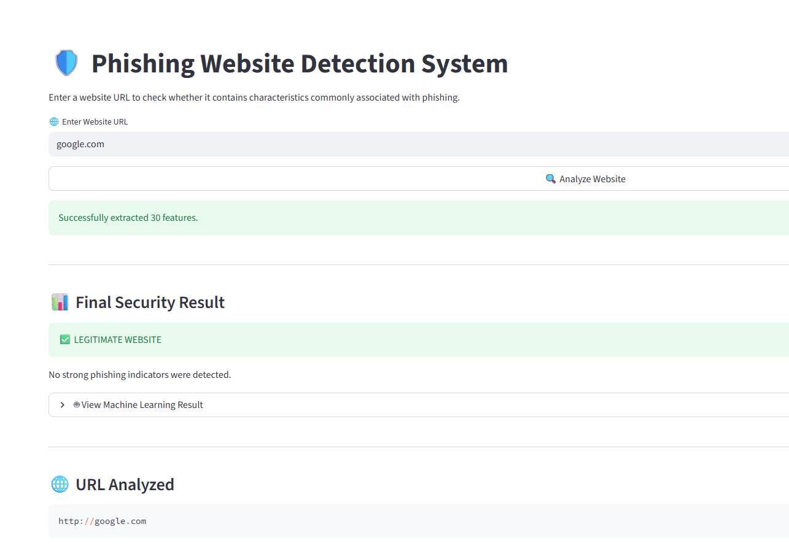
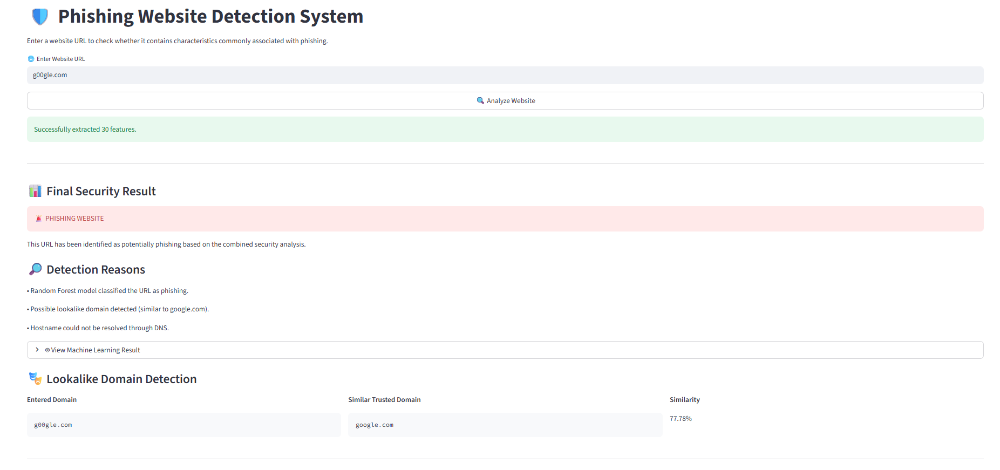
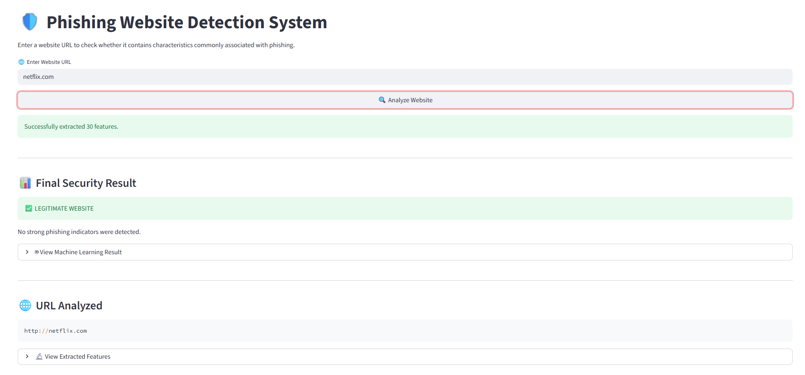
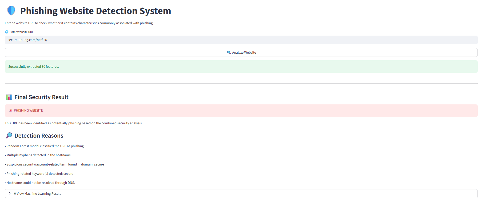
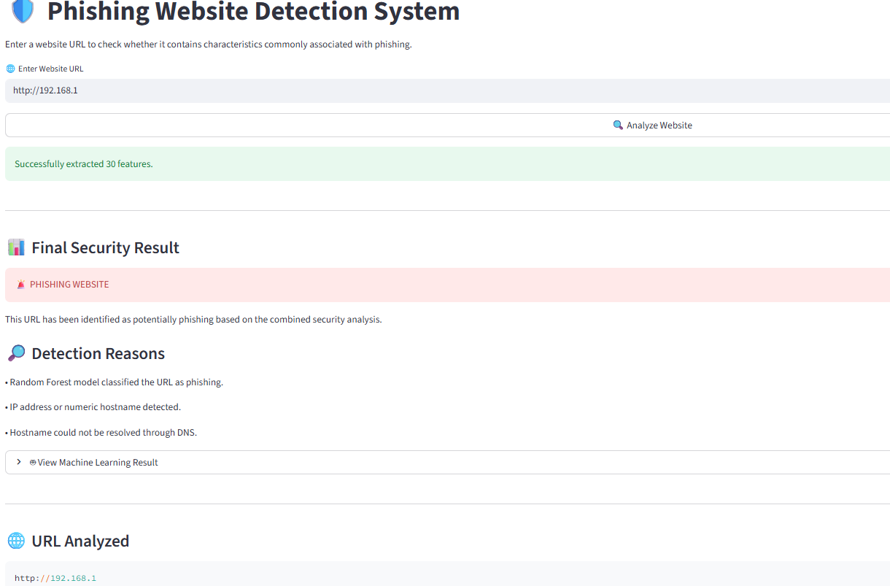
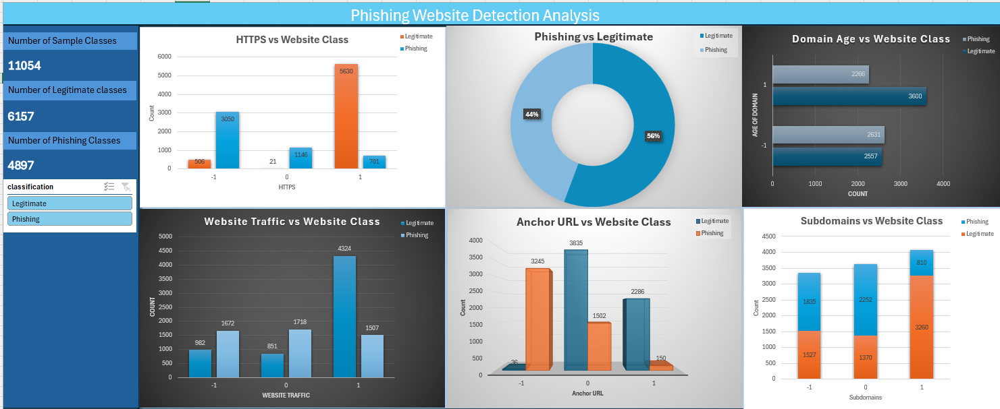

# 🛡️ Phishing Website Detection System

A machine learning based web application that detects whether a website URL is potentially **phishing** or **legitimate**.

The project combines **data analysis, feature extraction, machine learning, and a Streamlit web application**.

## 📌 Project Overview

The system accepts a website URL, extracts website and URL-based features, and uses a trained **Random Forest Classifier** to classify the website.

The application displays:

- Website classification
- Detection reasons
- Machine learning result
- Extracted website features
- Lookalike domain detection
- URL analysis information

## 🧠 Technologies Used

- Python
- Pandas
- NumPy
- Scikit-learn
- Random Forest Classifier
- Streamlit
- BeautifulSoup
- Requests
- Joblib
- TLDExtract
- Python WHOIS
- Jupyter Notebook
- Microsoft Excel

## 📂 Project Structure

```text
phishing-website-detection/
│
├── app.py
├── feature_extraction.py
├── domain_similarity.py
├── model.pkl
├── feature_names.pkl
├── phishing.csv
├── phishing_dataset_dashboard.xlsx
├── Phishing_Detection_Analysis.ipynb
│
├──  
│       ├── screenshot_01.png
│       ├── screenshot_02.png
│       ├── screenshot_03.png
│       ├── screenshot_04.png
│       ├── screenshot_05.png
│       └── dashboard.png
│
├── README.md
└── .gitignore
```

## 🔍 Website Features

The feature extraction module analyzes website characteristics including:

- IP address usage
- URL length
- URL shortening
- `@` symbol
- Redirecting URLs
- Prefix/Suffix
- Subdomains
- HTTPS
- Domain registration length
- Non-standard ports
- Favicon
- Request URL
- Anchor URL
- Links in script tags
- Server form handler
- Information email
- Abnormal URL
- Website forwarding
- Status bar customization
- Disabled right click
- Popup windows
- Iframe redirection
- Domain age
- DNS recording
- Website traffic
- PageRank
- Google index
- Links pointing to page
- Statistical/reputation information

## 🤖 Machine Learning Model

The project uses a **Random Forest Classifier** for website classification.

The trained model is stored in:

```text
model.pkl
```

The feature names used by the trained model are stored in:

```text
feature_names.pkl
```

The model uses the extracted features to classify a website and provide a machine learning result.

## 🌐 Streamlit Web Application

The project includes an interactive Streamlit application.

Users can enter a URL such as:

```text
https://example.com
```

and click:

```text
🔍 Analyze Website
```

The application then extracts the website features and performs the security analysis.

### Application Screenshots

#### 1. Legitimate Website Detection



#### 2. Lookalike Domain Detection



#### 3. Legitimate Website Detection - Netflix



#### 4. Phishing Website Detection



#### 5. IP Address / Numeric Hostname Detection



## 📊 Data Analytics Dashboard

An Excel dashboard was created to analyze the phishing dataset.

The dashboard contains visualizations for:

- Number of sample classes
- Number of legitimate classes
- Number of phishing classes
- HTTPS vs Website Class
- Phishing vs Legitimate distribution
- Domain Age vs Website Class
- Website Traffic vs Website Class
- Anchor URL vs Website Class
- Subdomains vs Website Class

### Dashboard Screenshot



## 📸 Project Screenshots

The repository includes screenshots showing different test cases and analysis results:

### Google - Legitimate Website


### Lookalike Domain Example


### Netflix - Legitimate Website


### Suspicious Domain - Phishing Result


### IP Address - Phishing Result


### Dataset Analysis Dashboard


## 📓 Jupyter Notebook

The Jupyter Notebook contains the project analysis and machine learning workflow.

```text
Phishing_Detection_Analysis.ipynb
```

It can be used to inspect the dataset, perform analysis, develop the model, and evaluate the machine learning workflow.

## 📁 Dataset

The dataset used for the project is:

```text
phishing.csv
```

The project also contains the Excel dashboard:

```text
phishing_dataset_dashboard.xlsx
```

It contains website-related features and classification information used for the phishing website detection project.

## 🔎 Lookalike Domain Detection

The project also includes:

```text
domain_similarity.py
```

This module checks whether an entered domain is similar to a trusted domain.

The application can display:

- Entered Domain
- Similar Trusted Domain
- Similarity Percentage

This helps identify possible lookalike domains used for website impersonation.

## 🚀 How to Run the Project

### 1. Clone the repository

```bash
git clone YOUR_GITHUB_REPOSITORY_URL
cd phishing-website-detection
```

### 2. Create a virtual environment (optional)

Windows:

```bash
python -m venv venv
venv\Scripts\activate
```

Linux/macOS:

```bash
python3 -m venv venv
source venv/bin/activate
```

### 3. Install dependencies

```bash
pip install -r requirements.txt
```

### 4. Run the Streamlit application

```bash
streamlit run app.py
```

### 5. Use the application

Open the Streamlit URL displayed in the terminal.

Enter a website URL and click:

```text
🔍 Analyze Website
```

The application will analyze the URL and display the prediction and detection reasons.

## ⚙️ Project Workflow

```text
Website URL
     │
     ▼
Feature Extraction
     │
     ▼
Website/URL Features
     │
     ▼
Random Forest Classifier
     │
     ├───────────────┐
     ▼               ▼
Machine Learning    Security Checks
Result                   │
                         ├── URL Analysis
                         ├── DNS Check
                         ├── Suspicious Keywords
                         └── Lookalike Domain
                                │
                                ▼
                       Combined Security Result
                                │
                                ▼
                         Streamlit Result
```

## ⚠️ Limitations

Some website characteristics require external information that cannot reliably be obtained from a URL alone. For these features, the current feature extraction implementation may use default values when the required external information is unavailable.

Website retrieval and DNS checks can also fail when a website blocks automated requests, is unavailable, or cannot be resolved.

Therefore, the prediction should be considered a machine-learning classification result rather than a definitive security verdict.

## 🔐 Disclaimer

This project is intended for **educational and research purposes**. Do not use the prediction as the sole basis for deciding whether a website is safe.

## 👨‍💻 Project Components

| Component                   | File                                |
| --------------------------- | ----------------------------------- |
| Web application             | `app.py`                            |
| Feature extraction          | `feature_extraction.py`             |
| Domain similarity detection | `domain_similarity.py`              |
| Trained model               | `model.pkl`                         |
| Model feature names         | `feature_names.pkl`                 |
| Dataset                     | `phishing.csv`                      |
| Machine learning notebook   | `Phishing_Detection_Analysis.ipynb` |
| Excel dashboard             | `phishing_dataset_dashboard.xlsx`   |
| Application screenshots     | `dashboard/`            |
| Dependencies                | `requirements.txt`                  |
| Documentation               | `README.md`                         |
